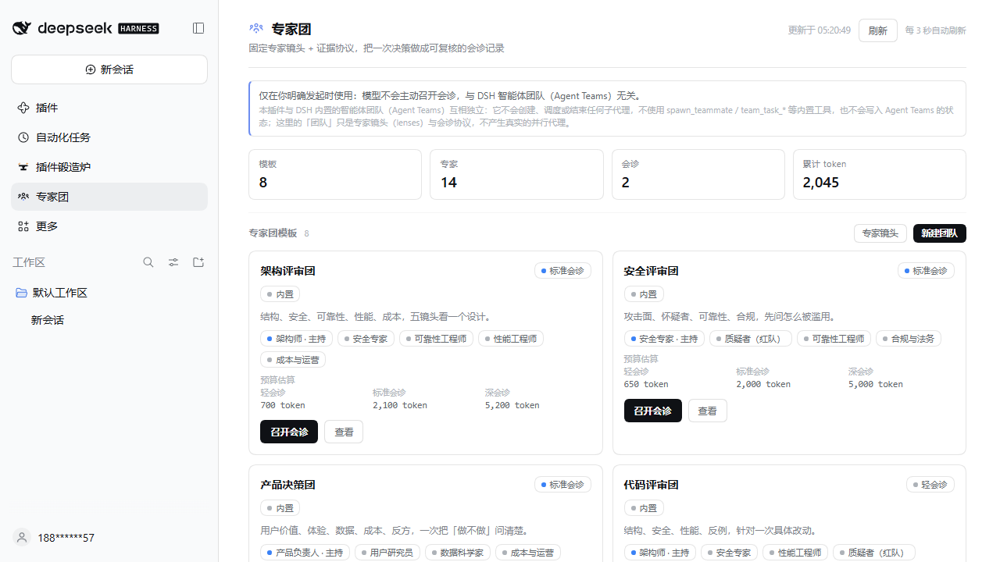
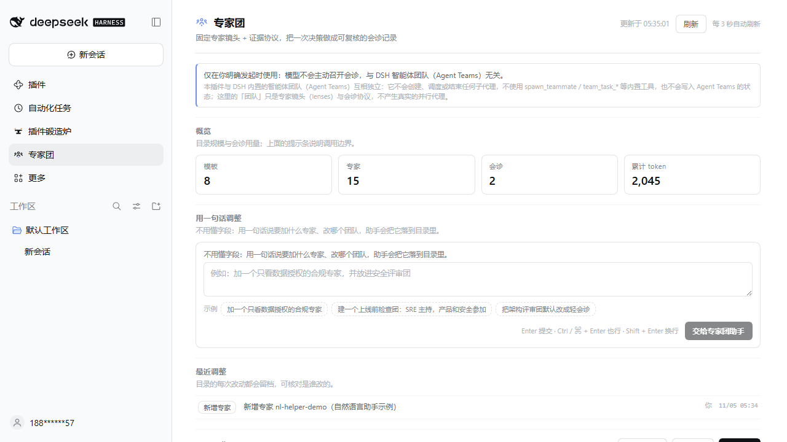
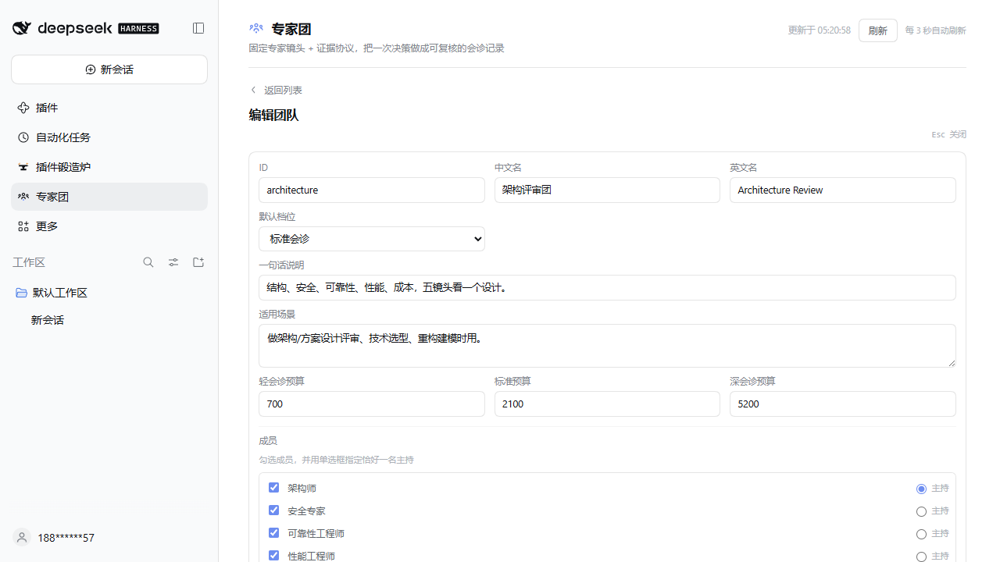
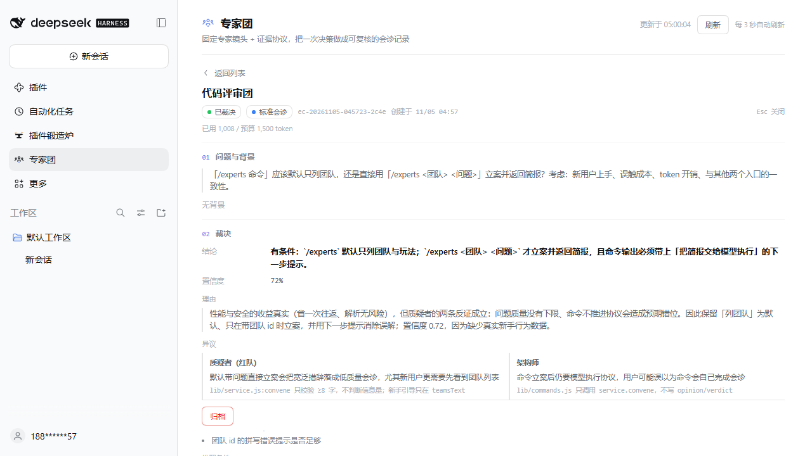

# Expert Council · dsh-expert-council

> One sentence, a panel of professionals, and a result you can use and audit. Review mode gives you a verdict with recorded dissent; task mode makes every expert ship a complete artifact and merges them into one final deliverable. No task boundaries: any subject, any output.

A plugin for [DeepSeek Harness](https://github.com/YansongG-HKU). The Host owns the expert roster, six professional lens baselines, the user's customisation layer, the protocol, the real-run executor, token accounting and the consult ledger; the Client renders the sidebar panel; the model gets one tool (`expert_council`), the human gets one command (`/experts`). All three write the same ledger.

**Three hard rules**

1. **User-gated only**: the model cannot convene or run a panel by itself. `/experts` and the panel are user actions; a model-initiated `convene`/`run` must carry `explicit_request:true` + `request_quote` (your own words) and is recorded as consent.
2. **Editable**: experts and team compositions can be changed any time — including in plain language, without knowing the fields.
3. **Isolated**: not the built-in DSH Agent Teams. It never spawns teammates, never calls `spawn_teammate` / `team_task_*`, and its "teams" are expert lenses plus a protocol.

## No task boundaries, two intents

The panel has no task boundaries: review a decision or produce anything — code, plans, copy, scripts, design, attack surfaces, financial models, experiments, business plans. Experts may work outside their lens/domain; cross-domain, sensitive or unusual work is never discounted or refused.

- **review** — independent opinions → cross-exam only on proven disagreement → chair verdict with dissent, unresolved questions and reversal triggers.
- **task** — every expert ships a complete usable artifact in parallel → the integrator merges one final deliverable (not a summary). A failed merge falls back to concatenating artifacts and is marked for human review.

```text
/experts run finance <decision>        # review
/experts task engineering <task>       # task mode
# panel: pick domain/team → 评审会诊 / 任务会诊 → run
# tool: expert_council({action:'run', domain:'security', intent:'task', question:'…'})
```

Domain packs (finance/legal/healthcare/engineering/research/security) are **lens baselines**, not task boundaries; any team/domain can take any task.

## Why it is not just pretty UI

| Mechanism | How it is enforced |
| --- | --- |
| Professional domains | 6 packs (finance / legal / healthcare / engineering / research / security), each with 5 domain experts, an evidence ladder (A–E), required evidence, red flags and artifact checklists; the domain standard goes into every expert prompt and the report |
| Real independent opinions | `action=run` makes the Host call the model once per expert in parallel; each expert sees only its own lens prompt, never the others' answers |
| Disagreement only | The Host detects real stance conflicts / confidence gaps (≥0.45) and cross-examines up to 4 involved experts; no disagreement means no cross-exam calls |
| Chair verdict | A chair model receives anonymised opinions, disagreements and cross-exam summaries, and must return `decision/confidence/rationale/dissent/unresolved/reversalTriggers/actions`; ignoring a proven disagreement forces a rewrite |
| Dissent on record | Verdicts carry `dissent / unresolved / reversalTriggers / actions`; the report has dedicated "dissent (not flattened)" and "reversal triggers" sections |
| Evidence gate | Every claim needs `evidence`; unevidenced claims are downgraded to assumptions and the report checks against the domain's evidence standards |
| Robustness | Per-call timeout, retry, JSON contract and one repair retry; a truncated chair reply is salvaged from its own fields, then a statistical "degraded verdict" is used and explicitly marked for human review; reasoning-only empty replies automatically retry with a bigger output budget; run failures such as `QUORUM_FAILED` name the provider/model and the remediation |
| Observability | Stage timeline (independent → cross-exam → peer review → verdict), per-expert status/latency/tokens, quorum, failed experts, over-budget and degradation warnings; `run_status` polling and `cancel_run` |
| Report | 8-section Markdown report saved as `runs/<runId>.md` (decision, expert table, disagreements, dissent, unresolved/reversal, actions, domain artifact checklist, run detail); readable via `action=report`, the panel, or `GET /expert-council/api/report?id=` |
| Task mode | `intent=task`: every expert ships a complete artifact, the integrator merges one final deliverable; report contains the final result, division of labor, per-expert artifacts, assumptions, risks and next steps |
| No task boundaries | Any subject, any output; experts may cross lenses/domains without being discounted, refused or shrunk; evidence is a review tool, not a gate on creation/execution |
| Decision ledger | Consults persist rounds, opinions, disagreements, verdict and run summary (`expertStatuses`, `reportAvailable`); a verdict can never be overwritten |
| Three entry points, one service | Tool, command and panel call the same `service` — one gate implementation, no drift |

## Screenshots






## Usage

### In a session

- `/experts` — list teams and how to use them
- `/experts domains` — list the six professional domain panels
- `/experts experts` — list all 44 expert lenses
- `/experts finance` — inspect a domain/team (members, agenda, evidence standards, budgets)
- `/experts finance should this company issue convertible bonds?` — open a consult
- `/experts run finance should this company issue convertible bonds?` — open a consult and **run the real panel immediately**
- `/experts 调整 add a privacy expert and put them in the security panel` — plain-language customisation brief

### From the panel

Sidebar 「专家团」 → pick a professional domain → fill the question (optional context / depth) → convene, or click 「真实会诊」 to run it: the detail view shows the stage timeline, each expert's status, cancel, and the final verdict with dissent and artifact checklist; the report can be viewed and downloaded.

### Plain-language customisation

Say what you want; the plugin turns it into a field-level brief (your words + current catalogue + allowed actions + field reference + rules + examples) and the model applies it through guarded writes. Model-side catalogue writes require `request_quote`; every change is recorded and reset restores the shipped catalogue.

## Domains and teams

| id | Domain | Experts | Artifacts |
| --- | --- | --- | --- |
| `finance` | Finance & Investment | CRO / compliance / valuation / quant / trading | IC memo, risk & compliance checklist, valuation & sensitivity table |
| `legal` | Legal & Compliance | litigator / transactional / regulatory / evidence / legal ops | legal opinion, risk checklist, dispute path |
| `healthcare` | Healthcare & Clinical | clinician / EBM & stats / regulatory & ethics / patient safety / HEOR | evidence-level table, safety & ethics checklist, guideline gap analysis |
| `engineering` | Engineering & Manufacturing | systems / safety & reliability / quality / certification / supply chain | design review with FMEA, certification gap list, production risk list |
| `research` | Research & Peer Review | domain / methods & stats / ethics & IRB / reproducibility / editor | graded review, reproducibility checklist, methodological flaws |
| `security` | Security & Data Compliance | red team / blue team / audit / privacy / supply chain | attack-path & detection matrix, remediation priorities, compliance/privacy gaps |

Domain team ids are `<domain>-review` (e.g. `finance-review`). Eight general-purpose panels remain: architecture, security review, product decision, code review, research review, incident retro, shipping review, red/blue debate. 14 general lenses + 30 domain lenses = 44 lenses; presets are data in `lib/experts.js` / `lib/teams.js` / `lib/domains.js`.

## Token economy

- Only the chosen team's lenses are rendered into the brief.
- Three depths: `lean` (one chair synthesis call, ~34% of the standard budget), `standard` (N independent calls + one cross-exam round + chair), `deep` (plus anonymous peer review, ~2.6×).
- Per expert output budget ≥1200 tokens on a normal route (≥2400 and cross-exam ≥1800 when reasoning), chair ≥3500 (reasoning tokens count); run summaries record real input/output/reasoning tokens and per-expert latency; over-budget is a warning, the report shows actual usage.
- Route and timeout: `run` follows the calling session's provider/model (`exec.agent.model.current()`, so switching the session model switches the panel; the Harness default is only a fallback). The per-call timeout is 90s by default, 180s on a reasoning route (`reasoningEffort` present and not `off`), and an explicit `call_timeout_ms` / `callTimeoutMs` always wins; use `max_parallel:1` on a single-slot self-hosted endpoint.
- `budget_cap` overrides the whole-consult cap (200–20000); `max_parallel`, `call_timeout_ms`, `wait_ms` are configurable.
- Default advice: lean for routine reviews, standard for real decisions, deep only for irreversible/high-cost ones.

## Install

```bash
# install into the profile (link: or a local spec) and enable the bundle
pnpm --dir <profile> add link:F:\dsh插件创造\workspace\dsh-expert-council
```

After enabling: 「专家团」 appears in the sidebar, `/experts` is available, and the `expert_council` tool is registered. Real runs require a default model in DSH (or provider/model in the plugin config).

## Data

- `$DSH_HOME/expert-council/consults.json` — ledger with consent, budgets, rounds, disagreements, verdict and run summary.
- `$DSH_HOME/expert-council/customization.json` — override layer and change history.
- `$DSH_HOME/expert-council/runs/<runId>.json` — full run transcript (every call, usage, warnings, failures).
- `$DSH_HOME/expert-council/runs/<runId>.md` — the 8-section Markdown report.

## Tests

```bash
node --check index.js
node --test "test/*.test.mjs"   # 76/76
```

`test/run.test.mjs` covers the real orchestration with a scripted fake LLM: parallel independence, JSON repair, quorum, cancellation, forced-dissent repair, lean mode, report persistence, tool wiring, domain metadata, empty-output retry, truncated-chair salvage, degraded verdict and domain persistence. `test/routing.test.mjs` covers session-route priority, reasoning/off stage budgets, call-timeout selection and failure diagnostics.

## Boundaries

- Not the built-in DSH Agent Teams: no `spawn_teammate` / `team_task_*` / `send_message`, no agent sessions; a real run is direct model calls from the Host.
- Separate namespace (`expert_council`, `/experts`, `dsh-expert-council`, `expert-council`, `ec-` ids); `lib/isolation.js` and tests assert zero collision.
- The verdict is decision support with recorded evidence gaps, not a replacement for the accountable human.
- No network access, no third-party code execution; token accounting is local.

## Version

- `0.5.2`: runs follow the session model route (`exec.agent.model.current()`), reasoning-route output floors for expert/cross-exam/chair calls, route-aware call timeout (90s/180s), and `QUORUM_FAILED` diagnostics with provider/model + remediation.
- `0.5.0`: task mode (parallel artifacts + merged deliverable), no task boundaries, lens baselines, task report.
- `0.4.0`: real panel execution, 6 professional lens baselines, durable reports, run progress/cancel/degradation, reasoning-model adaptation.
- `0.3.0`: plain-language customisation, editable experts/teams.
- `0.2.0`: explicit-use consent, customisation, isolation boundary.
- `0.1.0`: first release (14 lenses, 8 teams, 7 rules, three budgets, three entry points, decision ledger).

