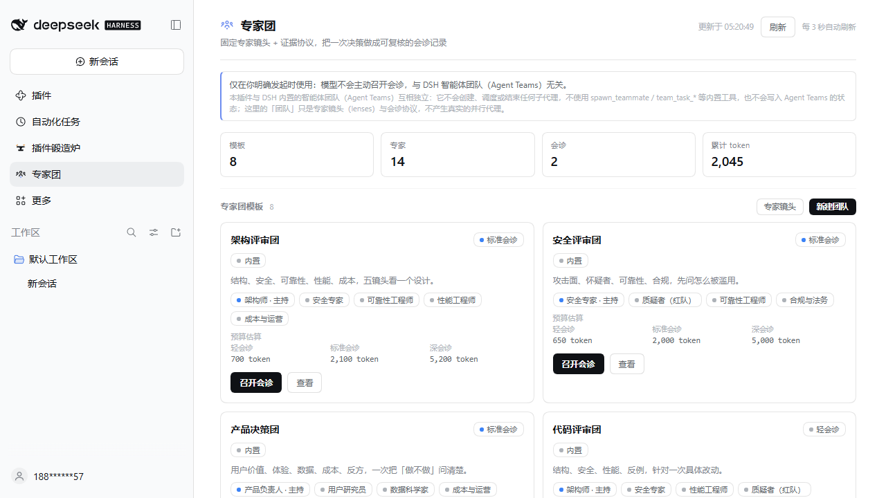
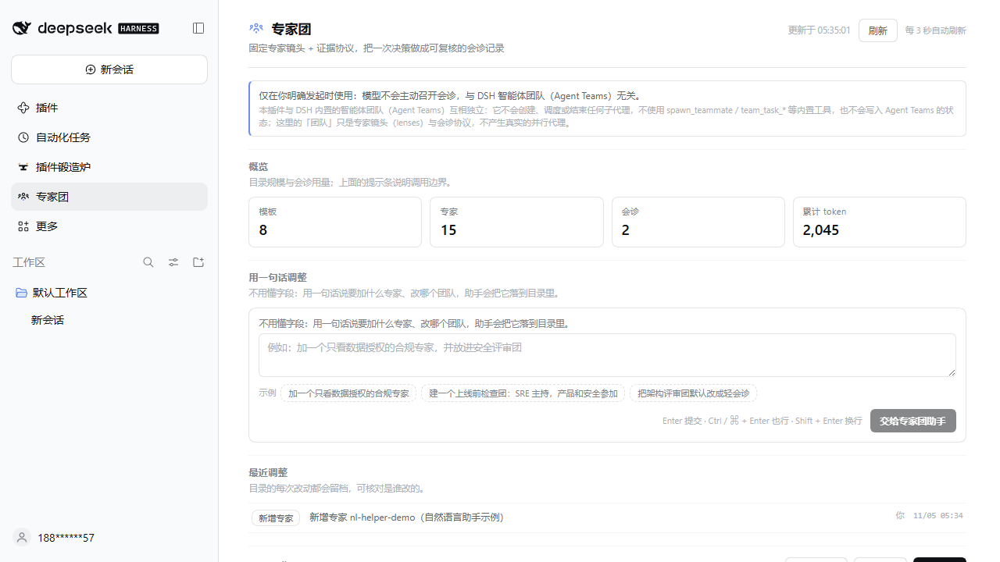
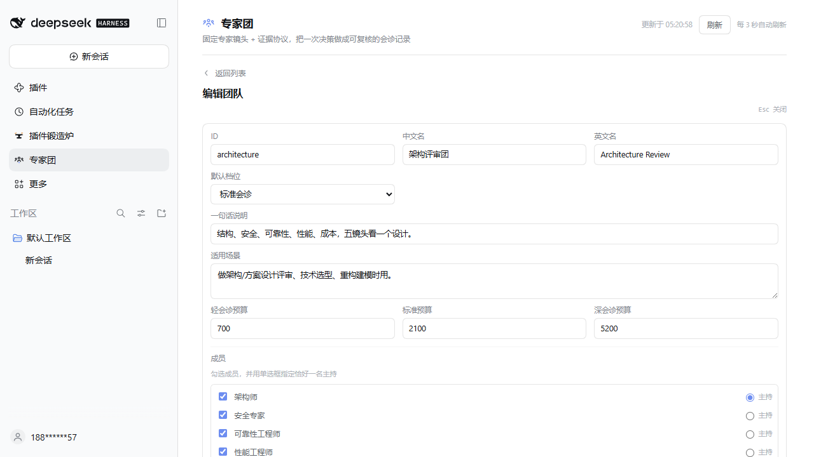
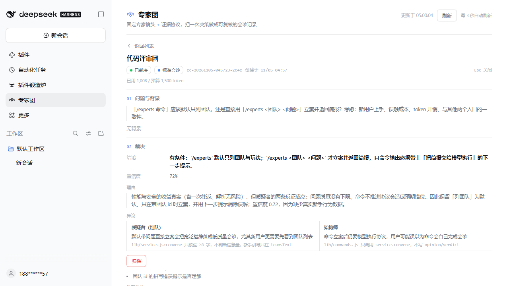

# 专家团 · dsh-expert-council

[](https://github.com/YansongG-HKU/dsh-expert-council/actions/workflows/ci.yml)
[](LICENSE)
[](package.json)

> 一句话，召集一群专家给你做一次**有纪律、可追溯**的评审。不是多开几个聊天，也不是让一个模型扮演五个角色：Host 会为每位专家**各发一次独立模型调用**，只对真正分歧做交叉质询，最后主持裁决并留下完整报告。

[English](README.en.md) · [规格](docs/SPEC.md) · [更新日志](CHANGELOG.md) · [贡献指南](CONTRIBUTING.md) · [与 Agent Teams 的对照](docs/BENCHMARK.md)

DeepSeek Harness 插件（MIT 开源）：https://github.com/YansongG-HKU/dsh-expert-council

> **兼容性（DSH 0.2.2-rc.1）**：只读公开接口（tools / systemPrompt / commands / webServer / slots / locale / llm）并逐条核对，无破坏性变化；58/58 测试通过，真实桌面运行时完成过 5 专家 + 4 路交叉质询 + 主持裁决的完整金融会诊。

Host 拥有专家镜头名册与 6 个专业领域包、用户自定义层、合作规范、真实运行执行器（LLM 调用编排）、token 记账与决策台账；Client 提供侧边栏面板与详情页；模型侧有一个工具 `expert_council`，人类侧有一条命令 `/experts`。三者写同一份台账。

**三条硬规则：** ① 只在你明确呼叫时使用（模型不得主动召开，工具层会拒绝）；② 专家角色与团队构成可以随时改、改完即时生效、可重置；③ 与 DSH 自带的智能体团队（Agent Teams）完全隔离，不共用名字、不创建子代理。

## 截图






## 为什么它能真正开会（不是表面好看）

| 机制 | 落地方式（不是提示词口号） |
| --- | --- |
| 专业领域 | 6 个领域包（金融/法律/医疗/工程/科研/安全），各有 5 位领域专家、证据等级阶梯（A–E）、必须核验项、红旗清单与交付物清单；领域标准会进入每位专家的 system prompt 和报告核对表 |
| 真实独立意见 | `action=run`：Host 为每位专家并行发起一次独立模型调用（`prepareCall`→`stream`），每人拿到只含自己镜头的 prompt，互不可见；不是角色扮演 |
| 只谈分歧 | Host 基于实际 stance/confidence 检测分歧（立场冲突或置信度差 ≥0.45），只把有分歧的专家送去交叉质询（最多 4 位）；没有分歧就跳过，不烧 token |
| 主持裁决 | 最后一位"主持"模型拿到匿名化的意见、分歧与交叉质询摘要，输出 `decision/confidence/rationale/dissent/unresolved/reversalTriggers/actions`；存在分歧却无 dissent 会被要求重写 |
| 异议留档 | 裁决必含 `dissent / unresolved / reversalTriggers / actions`；报告单列"异议（不抹平）"与"推翻条件" |
| 证据门槛 | 每条 claim 必须带 `evidence`；无证据的意见降级为假设，工具返回 `evidenceWarnings`，报告按领域证据标准核对 |
| 鲁棒性 | 每次调用有超时、重试、JSON 契约与一次修复重试；主持输出截断时先从文本抢救结论，再退回按意见统计的**降级裁决**（报告显式标注需人工复核）；推理模型"无可见输出"会自动加预算重试 |
| 可观测 | 运行阶段（独立成稿→交叉质询→同行评议→主持裁决）、逐专家状态/耗时/token、法定人数、失败专家、超预算与降级警告；`run_status` 轮询、`cancel_run` 取消 |
| 报告 | 8 节 Markdown 报告落盘 `runs/<runId>.md`：结论、专家意见表、分歧与交叉质询、异议、未决/推翻条件、行动项、领域交付物核对、运行明细；面板可查看/下载，`action=report` 可读 |
| 决策台账 | 会诊持久化到 `consults.json`：轮次、意见、分歧、裁决、运行摘要（含 `expertStatuses` 与 `reportAvailable`）；`get/list/archive` 可复查；禁止覆盖已裁决的会诊 |
| 三入口一致 | `/experts`、面板、`expert_council` 工具全部调用同一个 `service`，门禁只有一份实现 |
| 显式调用门禁 | 模型主动 `convene` 会被拒绝；必须带 `explicit_request:true` + `request_quote`（用户原话），或由 `/experts` / 面板发起；同意记录写入 consult 台账 |
| 可自定义 | 专家与团队是「预置代码 + 用户数据」两层：可新增、可覆盖内置、可隐藏、可重置；面板编辑或 `save_expert` / `save_team` 写入 `customization.json`，立即生效 |
| 与内置团队隔离 | 独立命名空间（`expert_council` / `/experts` / `dsh-expert-council` / `expert-council`）；不 import Agent Teams 服务、不调用 `spawn_teammate` / `team_task_*`、不创建子代理；`checkIsolation()` 有测试兜底 |

## 谁能用、什么时候用（显式调用）

- 你明确发起才算数：`/experts run <领域|团队> <问题>`、面板「真实会诊」、或对话里点名「用专家团…」。
- 模型不能自作主张：默认提示词是**被动**的；工具 `convene`/`run` 不带 `explicit_request` + `request_quote` 会被拒绝，错误信息会要求它改由你发起。
- 每次会诊的 `consent` 都记进台账（`user-action` / `explicit-request` + 原话），事后可查是谁发起的。
- 读动作（`teams/experts/domains/get/list/report`）不受门禁影响；它们只用于回答你的点名请求。

## 三种打开方式

1. **斜杠命令**（会话里最轻）：
   - `/experts` — 看团队清单与玩法
   - `/experts domains` — 看 6 个专业领域评审团
   - `/experts experts` — 看全部 44 个专家镜头定义
   - `/experts finance` — 看领域/团队议程、成员、证据标准、预算
   - `/experts finance 这家公司该不该发可转债？` — 立案，拿到会诊简报
   - `/experts run finance 这家公司该不该发可转债？` — 立案并**立即真实会诊**
2. **面板**：侧边栏「专家团」→ 选专业领域 → 填问题（可选背景/档位）→「立案」或「真实会诊」→ 详情页实时看阶段与每位专家状态；裁决后可查看/下载报告。
3. **模型工具**：会话里点名「叫专家团真实评审一下 X」后，模型调用
   `expert_council({action:'run', domain:'finance', question, explicit_request:true, request_quote:'<你的原话>'})`，或先 `domains` 再 `convene` + `run`；也可按协议手工 `record` → `verdict`。

## 专业领域评审团（6 个）

| id | 领域 | 专家 | 交付物 |
| --- | --- | --- | --- |
| `finance` | 金融与投研 | 风险官 / 监管合规 / 估值会计 / 量化数据 / 交易执行 | 投委会备忘录、风险与合规清单、估值与敏感性分析表 |
| `legal` | 法律与合规 | 诉讼 / 交易 / 监管合规 / 证据取证 / 法务运营 | 法律意见书、风险与合规清单、争议解决路径图 |
| `healthcare` | 医疗与临床 | 临床 / 循证统计 / 监管伦理 / 患者安全 / 卫生经济 | 临床证据等级表、安全与伦理审查清单、指南差距分析 |
| `engineering` | 工程与制造 | 系统工程 / 安全可靠性 / 质量 / 标准认证 / 供应链 | 设计评审记录（含 FMEA）、认证差距清单、量产风险清单 |
| `research` | 科研与论文 | 领域专家 / 方法统计 / 伦理 IRB / 可复现 / 期刊编辑 | 分级评审意见、可复现性检查清单、方法学缺陷清单 |
| `security` | 网络与数据合规 | 红队 / 蓝队检测 / 合规审计 / 隐私 / 供应链安全 | 攻击路径与检测覆盖矩阵、修复优先级、合规/隐私差距 |

每个领域团队 id 为 `<domain>-review`（如 `finance-review`），默认档 `standard`，预算 750–900 / 2200–2600 / 5500–6500 token（lean/standard/deep）。

## 通用团队（8 个）

| id | 名称 | 成员 | 默认档 |
| --- | --- | --- | --- |
| `architecture` | 架构评审团 | architect / security / sre / performance / cost | standard |
| `security-review` | 安全评审团 | security / skeptic / sre / legal | standard |
| `product-decision` | 产品决策团 | product / ux / data / cost / skeptic | standard |
| `code-review` | 代码评审团 | architect / security / performance / skeptic | lean |
| `research-review` | 研究评议团 | domain / researcher / data / skeptic | standard |
| `incident-retro` | 事故复盘团 | sre / security / operator / data | standard |
| `shipping` | 上线评审团 | operator / sre / security / product | lean |
| `debate` | 红蓝对抗团 | skeptic / domain / architect / integrator | deep |

## 专家镜头（14 通用 + 30 领域）

结构：`architect` 架构师、`performance` 性能工程师、`data` 数据科学家、`researcher` 研究者；
风险：`security` 安全专家、`sre` 可靠性工程师、`legal` 合规与法务、`skeptic` 质疑者（红队）；
用户：`product` 产品负责人、`ux` 用户研究员、`domain` 领域专家；
执行：`cost` 成本与运营、`integrator` 综合者（主持）、`operator` 落地与运维。

领域专家 id 前缀：`finance-*` / `legal-*` / `health-*` / `eng-*` / `research-*` / `sec-*`，定义在 `lib/domains.js`；通用镜头在 `lib/experts.js`；通用团队在 `lib/teams.js`；都是数据，加人/加团队不改流程代码。

## 自定义专家与团队

- 面板里可以：新建/编辑专家（职责、镜头、必问、红线、**盲区**、可选所属领域、预算）、新建/编辑团队（成员、恰好一个主持、议程、产出物、三档预算）、隐藏内置模板、重置回出厂。
- 数据落在 `$DSH_HOME/expert-council/customization.json`；内置名册仍由代码提供，改内置=写入同 id 的覆盖层（标记 `custom:true`，`preset:true`），不会修改代码。
- 模型侧也可写：`expert_council({action:'save_expert', expert:{...}, request_quote:'<你的原话>'})`、`save_team`、`delete`、`reset({confirm:true})`；校验在 service 层（id、必填、成员存在、单主持、预算单调）。
- 每次改动都会写入 `history`（谁、什么动作、你的原话、影响），面板「最近调整」可查。

## 用一句话调整（不用懂配置）

1. **面板**：列表页「用一句话调整」→ 填一句话（或点示例 chip）→「交给专家团助手」→ 拿到字段级简报，模型用工具把改动落到目录里。
2. **命令**：`/experts 调整 加一个只看数据授权的合规专家，并放进安全评审团` —— 直接返回同一份简报。
3. **模型工具**：`expert_council({action:'customize', request:'<你的原话>'})` 拿到简报，再用 `save_expert` / `save_team` / `delete`（均带 `request_quote`）落库。

安全边界：模型侧任何目录写入同样需要 `request_quote`；破坏性操作要求先说明影响；所有改动可一键重置回出厂。

## Token 经济

- **只加载选中的镜头**：brief 只渲染本团专家卡。
- **三档**：`lean`（一次主持综合调用，约 34% 预算）、`standard`（N 路独立 + 一轮交叉质询 + 主持）、`deep`（再加匿名同行评议，约 2.6×）。
- **真实调用额度**：每位专家输出上限 ≥1200 token、主持 ≥3500 token（推理模型的思考 token 也计入），避免推理烧完额度没有可见输出。
- **记账**：运行摘要记录实际 input/output/reasoning token、逐专家耗时与状态；超预算 20% 返回告警但不中断，报告会写出实际用量。
- **可调**：`budget_cap` 覆盖总量（200–20000 token）；`max_parallel`（1–8）、`call_timeout_ms`、`wait_ms` 可调。
- 默认建议：日常评审用 lean；重要但可逆用 standard；不可逆/高成本决策才升 deep。

## 安装与启用

```bash
# 在工作区安装（link: 或本地 spec），随后在 profile 里启用 bundle
pnpm --dir <profile> add link:F:\dsh插件创造\workspace\dsh-expert-council
```

启用后：侧边栏出现「专家团」，`/experts` 可用，`expert_council` 工具注册到所有会话。真实会诊需要在 DSH 里选择默认模型（或在插件配置里指定 `provider` / `model`）。

## 数据

- `$DSH_HOME/expert-council/consults.json`：会诊台账，含 `consent`、`budget`、`rounds`、`disagreements`、`verdict`、`run` 摘要（`expertStatuses` / `reportAvailable`）；原子写入、上限 200 条。
- `$DSH_HOME/expert-council/customization.json`：专家/团队覆盖层与调整历史。
- `$DSH_HOME/expert-council/runs/<runId>.json`：完整运行转录（每次调用、用量、警告、失败）。
- `$DSH_HOME/expert-council/runs/<runId>.md`：8 节 Markdown 会诊报告（可直接下载归档）。

## 验收

```bash
node --check index.js
node --test "test/*.test.mjs"   # 58/58
```

`test/run.test.mjs` 用脚本化假 LLM 覆盖真实编排：并行独立性、JSON 修复、法定人数、取消、主持强制异议修复、lean 单调用、报告落盘、工具链路、领域元数据、空文本重试、截断裁决抢救、降级裁决、领域字段持久化。

## 与 DSH 智能体团队的边界（详见 docs/BENCHMARK.md）

- 本插件**不是** Agent Teams：不注册/不调用 `spawn_teammate`、`team_task_*`、`send_message` 等内置工具，不创建、不调度、不结束任何子代理。
- 这里的「团队」是镜头集合 + 会诊协议；真实会诊由 Host 直接发起模型调用，并不产生代理会话。
- 命名空间独立：工具 `expert_council`、命令 `/experts`、面板 id `dsh-expert-council`、数据目录 `expert-council`、会诊 id 前缀 `ec-`；`lib/isolation.js` 集中声明并用测试断言不与内置 Agent Teams 名字冲突。
- 两者可以并用：Agent Teams 适合"派活执行"，专家团适合"专业评审与留痕"。

## 边界

- 不做「自动投票取胜」：裁决由主持给出并必须回应异议，分歧不会被平均掉。
- 不替代真实专家：真实会诊给出的是结构化判断与证据缺口，关键决策仍需 human-in-the-loop。
- 不碰网络、不执行第三方代码；审计/令牌只做本地统计。

## 本轮验收证据（V0.4）

- 自动化：`node --test "test/*.test.mjs"` → **58/58**（core 6 + service 6 + api 3 + custom 6 + customize 6 + domains 7 + client 10 + run 14）。
- 真实运行（desktop profile，deepseek-account/deepseek-flash，标准金融会诊）：
  - 5 位专家并行独立成稿（全部成功，5/5 法定人数）；
  - 检测到 3 处分歧 → 4 路交叉质询并写回第 2 轮修订；
  - 主持输出「不做（当前材料下不予批准，非永久否决）」+ 3 条推翻条件 + 行动项；
  - 45.5s、16,857 token；8 节报告落盘，含逐专家调用明细。
- 面板：领域卡、真实会诊时间线、取消、报告查看/下载、逐专家状态、领域交付物 checklist；client 测试通过。

## 版本

- `0.4.0`：真实会诊（Host 并行调用每位专家 + 交叉质询 + 主持裁决 + 8 节报告）、6 个专业领域评审团、运行进度/取消/降级、推理模型适配。
- `0.3.0`：自然语言调整、自定义专家团队、界面分区。
- `0.2.0`：显式调用门禁（consent 落库）、自定义与隔离边界。
- `0.1.0`：首次发布（14 镜头、8 团队、7 铁律、三档预算、三入口、决策台账）。
